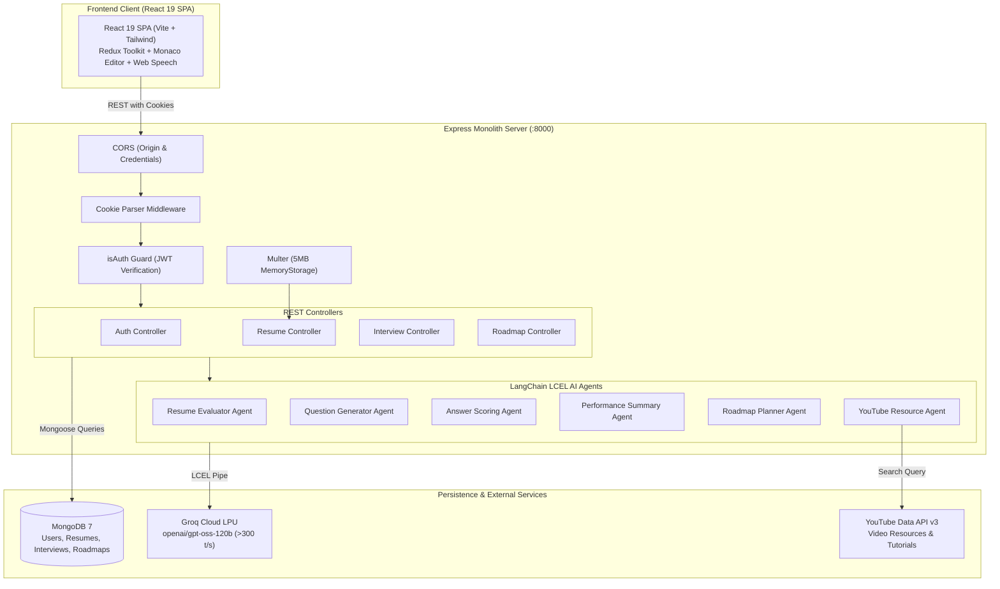

# PrepTrace ⚡ High-Throughput AI Career Intelligence & Mock Interview Platform

[](https://nodejs.org/)
[](https://expressjs.com/)
[](https://www.mongodb.com/)
[](https://mongoosejs.com/)
[](https://react.dev/)
[](https://vitejs.dev/)
[](https://tailwindcss.com/)
[](https://redux-toolkit.js.org/)
[](https://js.langchain.com/)
[](https://groq.com/)
[](https://jwt.io/)

> ⚡ **Monolith Backend API**: [http://localhost:8000/api](http://localhost:8000/api)  
> 🌐 **React 19 Frontend Client**: [http://localhost:5173/](http://localhost:5173/)  
> 🗄️ **Primary Document Store**: Local MongoDB (`mongodb://127.0.0.1:27017/preptrace`)  
> 📐 **Systems Architecture & HLD/LLD Specification**: [preptrace_system_hld.md](preptrace_system_hld.md)  
> 🎓 **Master SDE Placement Study Guide**: [INTERVIEW_STUDY_GUIDE.md](INTERVIEW_STUDY_GUIDE.md)  
> 📄 **Master Resume Points & LaTeX Code**: [RESUME_POINTS.md](RESUME_POINTS.md)

---

## 1. Executive Overview

**PrepTrace** is a high-speed, full-stack AI career intelligence platform architected to empower software engineers with automated ATS resume evaluation, multi-turn AI mock technical and behavioral interviews with real-time speech synthesis, and intelligent career roadmap generation with curated video tutorials.

### The Problem It Solves
1. **Unrealistic Latency in AI Interviews**: Most AI mock interviewers rely on standard cloud GPU endpoints, resulting in 8–12 second wait times per conversational turn, destroying candidate engagement.
2. **Fragile Distributed Graph Complexity**: Implementations using distributed state machines (LangGraph) and distributed caches (Redis) suffer from state deserialization bugs, network hops, and container bloat.
3. **Paywalls & Artificial Coin Limits**: Common platforms restrict candidate practice behind credit tokens and expensive subscriptions.

### The Solution Architecture
PrepTrace resolves these challenges through a clean, pedagogical, high-performance architecture:
* **Sub-2-Second Groq LPU Inference**: Harnesses Groq's Tensor Streaming Processor architecture running `openai/gpt-oss-120b` via `@langchain/groq`, delivering >300 tokens/sec for fluid, real-time interview dialogue.
* **Streamlined MVC Monolith**: Replaces complex microservices and distributed graphs with an Express.js monolith and linear LangChain LCEL pipelines, persisting conversation history directly inside atomic MongoDB documents.
* **In-Memory Binary Extraction**: Processes PDF resumes in RAM via `multer.memoryStorage` and `pdf-parse`, achieving sub-250ms text extraction without disk I/O bottlenecks.
* **Zero-Trust HTTP-Only Authentication**: Features custom bcrypt password hashing (10 salt rounds) and signed JWT tokens dispatched via HTTP-only, SameSite cookies to defend against XSS and CSRF attacks.
* **100% Free & Unlocked**: Zero coin barriers, zero payment gateways, and unlimited practice for all registered candidates.

---

## 2. Core Implemented Features

### 📄 Intelligent ATS Resume Evaluator
* **Sub-250ms PDF Parsing**: Memory-buffered binary extraction eliminates temporary disk writes and security liabilities.
* **Rubric-Based Scoring**: Evaluates candidate resumes across keyword match density, project impact, readability, and technical breadth to produce an objective 0–100 ATS score.
* **Actionable Feedback**: Generates categorized strengths, weaknesses, recommended project upgrades, and missing industry keywords.

### 🎙️ Multi-Turn AI Mock Interviewer
* **Adaptive Question Generation**: Generates progressive, role-specific questions tailored to candidate seniority (Entry, Mid, Senior) and interview type (Technical or HR).
* **Browser Voice Synthesis**: Reads questions aloud using the native Web Speech API (`SpeechSynthesis`) with customizable voice selection.
* **Live In-Browser Code Editor**: Integrated Monaco Code Editor (VS Code engine) for writing and submitting formatted algorithmic solutions.
* **Instant Turn Feedback & Scoring**: Scores each answer from 0 to 10 with constructive feedback, identified gaps, and exemplary model answers.
* **Comprehensive Performance Radar**: Calculates aggregate technical accuracy, problem-solving, and communication scores upon completion.

### 🗺️ AI Career Roadmap Architect & Resource Resolver
* **Personalized Timeline Generator**: Constructs detailed, week-by-week learning curricula for any tech stack or role (e.g. MERN Full Stack, DevOps, AI/ML) targeting specific salary brackets (e.g. 20 LPA, 40 LPA).
* **Automated YouTube Tutorial Curations**: Enriches every topic with relevant, high-yield YouTube video lessons via the YouTube Data API v3 with intelligent query fallbacks.

### 🛠️ Interactive ATS Resume Builder
* **Live In-Browser Customization**: Form fields for personal details, work experience, education, skills, and portfolio projects.
* **Pixel-Perfect ATS Template**: Clean, standard layout designed for automated resume parsers.
* **Browser-Native PDF Export**: Integrates `react-to-print` for 1-click high-resolution PDF printing without server-side headless browser dependencies.

### 🔐 Custom Authentication & Profile Security
* **Stateless JWT in HTTP-Only Cookies**: Eliminates client-side token vulnerabilities; cookies are automatically attached to all authenticated requests via `credentials: true`.
* **Bcrypt Password Security**: Hashes user passwords with 10 salt rounds before database persistence.

---

## 3. Technology Stack

| Layer | Technology | Version | Purpose in PrepTrace |
|---|---|---|---|
| **Frontend Framework** | React | `19.2.7` | High-performance reactive UI with modern hooks and concurrent features. |
| **Build Tooling** | Vite | `8.1.1` | Instant HMR development server and optimized rollup production bundles. |
| **Styling System** | Tailwind CSS | `4.3.3` | Utility-first responsive design tokens and dark mode styling. |
| **Global State** | Redux Toolkit | `2.12.0` | Centralized state management for candidate resumes and live editing. |
| **Routing** | React Router DOM | `7.18.1` | Client-side declarative routing and protected views. |
| **Code Editor** | Monaco Editor | `4.7.0` | In-browser VS Code editor engine for technical interview questions. |
| **Visual Charts** | Recharts | `3.10.0` | Radial progress gauges and interview performance radar charts. |
| **Backend Runtime** | Node.js | `v20+` / `v22+` | Event-driven, non-blocking asynchronous server environment. |
| **Web Framework** | Express.js | `4.21.2` | RESTful API monolith with middleware pipelines. |
| **Database Engine** | MongoDB | `7.0+` | Primary document store for users, resumes, interviews, and roadmaps. |
| **Object Modeling** | Mongoose | `8.12.1` | Schema validation, type casting, and indexed document queries. |
| **AI Orchestration** | LangChain Core | `1.2.12` | Reusable prompt templates, LCEL runnable pipelines, and JSON extraction. |
| **Inference Hardware**| Groq LPU Cloud | `openai/gpt-oss-120b` | Ultra-fast language inference engine (>300 tokens/sec). |
| **PDF Extraction** | pdf-parse | `2.4.5` | In-memory binary buffer parser for PDF documents. |
| **File Handling** | Multer | `2.4.0` | In-memory multipart/form-data upload middleware. |
| **Authentication** | JWT / bcryptjs | `9.0.2` / `2.4.3` | Stateless JSON Web Tokens and 10-round salted password hashing. |

---

## 4. System Architecture



---

## 5. Repository Structure

```text
preptrace/
├── backend/
│   ├── config/
│   │   ├── db.js                 # MongoDB connection using Mongoose
│   │   ├── llm.js                # ChatGroq LLM initialization (120B model)
│   │   ├── pdf.js                # pdf-parse text extraction utility
│   │   └── youtube.js            # YouTube Data API v3 client & fallback search
│   ├── models/
│   │   ├── user.model.js         # User identity schema (name, email, password)
│   │   ├── resume.model.js       # ATS resume analysis & extracted metadata
│   │   ├── interview.model.js    # Multi-turn interview questions, answers & scores
│   │   └── roadmap.model.js      # Structured week-by-week curriculum & video links
│   ├── middleware/
│   │   ├── isAuth.js             # JWT verification from HTTP-only cookie
│   │   └── multer.js             # 5MB in-memory PDF upload handler
│   ├── controllers/
│   │   ├── auth.controller.js    # Register, login, logout, getMe
│   │   ├── resume.controller.js  # Upload & evaluate PDF resumes
│   │   ├── interview.controller.js # Start, step-through, and summarize interviews
│   │   └── roadmap.controller.js # Generate and fetch career roadmaps
│   ├── agents/
│   │   ├── resume.agent.js       # LangChain LCEL pipeline for ATS scoring
│   │   ├── interview.agent.js    # Dynamic question generation pipeline
│   │   ├── feedback.agent.js     # Single-turn answer evaluation pipeline
│   │   ├── summary.agent.js      # Final interview report calculation
│   │   ├── roadmap.agent.js      # Tech stack roadmap curriculum generator
│   │   └── resource.agent.js     # Resource curation & YouTube linking agent
│   ├── prompts/
│   │   ├── technicalInterviewPrompt.js # Deep technical evaluation system prompts
│   │   ├── hrInterviewPrompt.js        # Behavioral STAR-method system prompts
│   │   ├── feedbackPrompt.js           # Rubric-based scoring system prompts
│   │   ├── summaryPrompt.js            # Holistic interview performance prompt
│   │   └── roadmapPrompt.js            # Weekly syllabus design system prompt
│   ├── routes/
│   │   ├── auth.routes.js        # /api/auth endpoints
│   │   ├── resume.routes.js      # /api/resume endpoints
│   │   ├── interview.routes.js   # /api/interview endpoints
│   │   └── roadmap.routes.js     # /api/roadmap endpoints
│   ├── server.js                 # Express server configuration & mount points
│   └── package.json              # Backend dependencies and scripts
└── frontend/
    ├── src/
    │   ├── apis/
    │   │   ├── interview.api.js  # Axios endpoints for interview operations
    │   │   ├── resume.api.js     # Multipart resume upload client
    │   │   └── user.api.js       # Current user query client
    │   ├── components/
    │   │   ├── interview/
    │   │   │   ├── CodeEditor.jsx   # Monaco code editor integration
    │   │   │   ├── Step1setup.jsx   # Role, experience & interview type setup
    │   │   │   ├── Step2interview.jsx # Live interview interface with voice TTS
    │   │   │   ├── Step3report.jsx  # Detailed performance breakdown
    │   │   │   └── Timer.jsx        # Per-question countdown timer
    │   │   ├── resume/
    │   │   │   ├── ATSTemplate.jsx  # Printable clean ATS resume template
    │   │   │   ├── DownloadBtn.jsx  # window.print / react-to-print exporter
    │   │   │   ├── PreviewResume.jsx# Real-time resume preview
    │   │   │   └── ResumeForm.jsx   # Form fields for personal/work/education data
    │   │   ├── roadmap/
    │   │   │   ├── ModuleCard.jsx   # Collapsible weekly module card
    │   │   │   └── RoadmapResult.jsx# Roadmap view with embedded video links
    │   │   ├── LoginModel.jsx    # Authentication modal (Sign In / Register)
    │   │   ├── Sidebar.jsx       # Navigation drawer with responsive state
    │   │   └── Statbox.jsx       # Dashboard KPI metric widget
    │   ├── pages/
    │   │   ├── Dashboard.jsx     # Overview of previous interviews & resumes
    │   │   ├── Home.jsx          # Public landing page with feature cards
    │   │   ├── InterviewPage.jsx # Root wrapper for interview workflow
    │   │   ├── ResumeBuilder.jsx # Full-page ATS resume creator
    │   │   ├── Roadmap.jsx       # Career roadmap builder & history view
    │   │   └── Scorer.jsx        # PDF resume upload & ATS score breakdown
    │   ├── redux/
    │   │   ├── resumeSlice.js    # Active resume state slice
    │   │   └── store.js          # Redux Toolkit centralized store
    │   ├── utils/
    │   │   └── axios.js          # Configured Axios instance with withCredentials: true
    │   ├── App.jsx               # Application route definitions
    │   └── main.jsx              # React DOM entry point
    └── package.json              # Frontend dependencies and scripts
```

---

## 6. Prerequisites

To run PrepTrace locally, ensure you have:
* **Node.js**: `v20.x` or higher
* **MongoDB**: Community Server `v7.0+` running locally on port `27017` (or MongoDB Atlas connection string)
* **Groq API Key**: Free API key from [console.groq.com](https://console.groq.com/)

---

## 7. Environment Configuration

### Backend Configuration (`backend/.env`)

```env
PORT=8000
MONGODB_URL=mongodb://127.0.0.1:27017/preptrace
JWT_SECRET=preptrace_super_secret_jwt_key_2026
FRONTEND_URL=http://localhost:5173
GROQ_API_KEY=gsk_your_groq_api_key_here
```

---

## 8. Installation & Quick Start

### 1. Start the Monolith Backend
```bash
cd backend
npm install
npm start
```
The backend starts on `http://localhost:8000` and automatically connects to local MongoDB.

### 2. Start the React Frontend
In a new terminal:
```bash
cd frontend
npm install
npm run dev
```
The application opens at `http://localhost:5173`.

---

## 9. REST API Reference

All protected routes automatically authenticate via the HTTP-only `token` cookie.

### 🔐 Authentication (`/api/auth`)

| Method | Endpoint | Auth | Description | Payload |
|---|---|---|---|---|
| `POST` | `/api/auth/register` | Public | Register new candidate account | `{ name, email, password }` |
| `POST` | `/api/auth/login` | Public | Login & receive HTTP-only JWT cookie | `{ email, password }` |
| `POST` | `/api/auth/logout` | Public | Clear JWT cookie & terminate session | _None_ |
| `GET` | `/api/me` | Bearer | Retrieve authenticated profile | _None_ |

### 📄 Resume Scorer (`/api/resume`)

| Method | Endpoint | Auth | Description | Payload |
|---|---|---|---|---|
| `POST` | `/api/resume/upload` | Cookie | Upload and evaluate ATS resume | `multipart/form-data` with `file` |
| `GET` | `/api/resume/get-resume` | Cookie | Get candidate's latest evaluated resume | _None_ |

### 🎙️ AI Mock Interview (`/api/interview`)

| Method | Endpoint | Auth | Description | Payload |
|---|---|---|---|---|
| `POST` | `/api/interview/start` | Cookie | Initialize new interview session | `{ role, experience, type }` |
| `POST` | `/api/interview/answer` | Cookie | Submit answer, get feedback & next turn | `{ interviewId, answer }` |
| `GET` | `/api/interview/:id` | Cookie | Retrieve interview report by ID | Path: `:id` |
| `GET` | `/api/interview/all` | Cookie | List all past interviews for candidate | _None_ |

### 🗺️ Career Roadmap (`/api/roadmap`)

| Method | Endpoint | Auth | Description | Payload |
|---|---|---|---|---|
| `POST` | `/api/roadmap/generate` | Cookie | Generate weekly tech syllabus with videos | `{ role, duration, targetPackage }` |
| `GET` | `/api/roadmap/all` | Cookie | List all generated roadmaps for user | _None_ |
| `GET` | `/api/roadmap/:id` | Cookie | Get specific roadmap by ID | Path: `:id` |

---

## 10. Security Architecture

1. **XSS & CSRF Defense**: Authentication tokens are stored exclusively in HTTP-only, SameSite cookies. Malicious client-side scripts cannot access `document.cookie`.
2. **Password Cryptography**: Salted password hashing using `bcryptjs` with 10 rounds guarantees resistance against rainbow-table and dictionary attacks.
3. **RAM Ingestion Safety**: Multer memory storage enforces a strict 5MB upload ceiling, protecting the Node.js V8 heap from buffer exhaustion and Out-of-Memory (OOM) crashes.
4. **Injection Protection**: Parameterized Mongoose queries eliminate NoSQL injection risks. LangChain role-separated prompt templates defend against prompt injection and rubric override attacks.

---

## 11. License & Maintainers

* **License**: MIT License
* **Maintainer**: **Abhishek** ([@23abhishek2024](https://github.com/23abhishek2024))
* **Repository**: [https://github.com/23abhishek2024/preptrace](https://github.com/23abhishek2024/preptrace)

