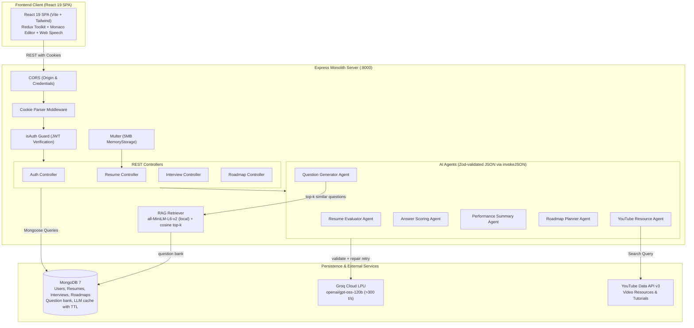

# PrepTrace ⚡ High-Throughput AI Career Intelligence & Mock Interview Platform

[](https://nodejs.org/)
[](https://expressjs.com/)
[](https://www.mongodb.com/)
[](https://mongoosejs.com/)
[](https://react.dev/)
[](https://vitejs.dev/)
[](https://tailwindcss.com/)
[](https://redux-toolkit.js.org/)
[](https://js.langchain.com/)
[](https://zod.dev/)
[](https://huggingface.co/docs/transformers.js)
[](https://groq.com/)
[](https://jwt.io/)

> ⚡ **Monolith Backend API**: [http://localhost:8000/api](http://localhost:8000/api)  
> 🌐 **React 19 Frontend Client**: [http://localhost:5173/](http://localhost:5173/)  
> 🗄️ **Primary Document Store**: Local MongoDB (`mongodb://127.0.0.1:27017/preptrace`)  
> 📐 **Systems Architecture & HLD/LLD Specification**: [preptrace_system_hld.md](preptrace_system_hld.md)  

---

## 1. Executive Overview

**PrepTrace** is a high-speed, full-stack AI career intelligence platform architected to empower software engineers with automated ATS resume evaluation, multi-turn AI mock technical and behavioral interviews with real-time speech synthesis, and intelligent career roadmap generation with curated video tutorials.

### The Problem It Solves
1. **Unrealistic Latency in AI Interviews**: Most AI mock interviewers rely on standard cloud GPU endpoints, resulting in 8–12 second wait times per conversational turn, destroying candidate engagement.
2. **Fragile Distributed Graph Complexity**: Implementations using distributed state machines (LangGraph) and distributed caches (Redis) suffer from state deserialization bugs, network hops, and container bloat.
3. **Paywalls & Artificial Coin Limits**: Common platforms restrict candidate practice behind credit tokens and expensive subscriptions.

### The Solution Architecture
PrepTrace resolves these challenges through a clean, pedagogical, high-performance architecture:
* **Sub-2-Second Groq LPU Inference**: Harnesses Groq's Tensor Streaming Processor architecture running `openai/gpt-oss-120b` via `@langchain/groq`, delivering >300 tokens/sec for fluid, real-time interview dialogue.
* **Streamlined MVC Monolith**: Replaces complex microservices and distributed graphs with an Express.js monolith and direct LangChain chat-model calls through one schema-validated JSON helper, persisting conversation history directly inside atomic MongoDB documents.
* **In-Memory Binary Extraction**: Processes PDF resumes in RAM via `multer.memoryStorage` and `pdf-parse`, so no temporary files are written to disk (5 MB upload limit).
* **Zero-Trust HTTP-Only Authentication**: Features custom bcrypt password hashing (10 salt rounds) and signed JWT tokens dispatched via HTTP-only, SameSite cookies to defend against XSS and CSRF attacks.
* **100% Free & Unlocked**: Zero coin barriers, zero payment gateways, and unlimited practice for all registered candidates.

---

## 2. Core Implemented Features

### 📄 Intelligent ATS Resume Evaluator
* **In-Memory PDF Parsing**: Resumes are parsed from memory (`multer.memoryStorage`, 5 MB limit). Scanned, image-only PDFs are detected and rejected with a clear message.
* **Rubric-Based Scoring, Computed in Code**: The LLM rates 5 criteria from 0–10 with one line of evidence each (keywords, impact, skills depth, experience & projects, structure). The 0–100 score is a weighted sum computed in `utils/atsScore.js`, so the model never invents the final number and every score comes with a breakdown.
* **Optional Job-Description Match**: Paste a job description and the keyword criterion is replaced by an exact, deterministic check of which JD skills appear in the resume (handles aliases such as Postgres/PostgreSQL and K8s/Kubernetes, and whole-word matching so "Java" never matches "JavaScript"). Required and nice-to-have skills are scored separately (80% / 20%), and "any one of C#, Java, Python..." counts as matched when the resume has one of them.
* **Actionable Feedback**: Strengths, weaknesses, missing skills (JD gaps first) and recommendations.

### 🎙️ Multi-Turn AI Mock Interviewer
* **RAG-Grounded Question Generation**: Retrieves the most relevant questions from a 167-question bank (local embeddings + cosine similarity) for the target role and resume, then generates 6 progressive questions (easy → hard) for Technical or HR rounds, personalized to the candidate's resume.
* **Skip & End Early**: Skip a question (scored 0, no AI call) or end the interview at any time and get a report on the questions answered so far.
* **Browser Voice Synthesis**: Reads questions aloud using the native Web Speech API (`SpeechSynthesis`) with customizable voice selection.
* **Live In-Browser Code Editor**: Integrated Monaco Code Editor (VS Code engine) for writing and submitting formatted algorithmic solutions.
* **Instant Turn Feedback & Scoring**: Scores each answer from 0 to 100 on 8 dimensions (correctness, clarity, relevance, detail, efficiency, communication, problem solving, creativity) with short feedback and 3 improvements. Empty answers score 0 without an LLM call.
* **Comprehensive Performance Radar**: Calculates aggregate technical accuracy, problem-solving, and communication scores upon completion.

### 🗺️ AI Career Roadmap Architect & Resource Resolver
* **Personalized Timeline Generator**: Constructs an ordered, module-by-module learning plan (8–15 modules with duration and difficulty) for any tech stack or role (e.g. MERN Full Stack, DevOps, AI/ML) targeting specific salary brackets (e.g. 20 LPA, 40 LPA).
* **Automated YouTube Tutorial Curations**: Enriches every topic with relevant, high-yield YouTube video lessons via the YouTube Data API v3 with intelligent query fallbacks.

### 🛠️ Interactive ATS Resume Builder
* **Live In-Browser Customization**: Form fields for personal details, work experience, education, skills, and portfolio projects.
* **Pixel-Perfect ATS Template**: Clean, standard layout designed for automated resume parsers.
* **Browser-Native PDF Export**: Integrates `react-to-print` for 1-click high-resolution PDF printing without server-side headless browser dependencies.

### 🔐 Custom Authentication & Profile Security
* **Stateless JWT in HTTP-Only Cookies**: Eliminates client-side token vulnerabilities; cookies are automatically attached to all authenticated requests via `credentials: true`.
* **Bcrypt Password Security**: Hashes user passwords with 10 salt rounds before database persistence.

---

## 3. AI Engineering

Every LLM feature goes through the same reliability layer. The goal: the model can be wrong, slow or attacked, and the app still behaves predictably.

| Concern | What PrepTrace does | Where |
|---|---|---|
| **Invalid LLM output** | Every reply is parsed (tolerates ```` ```json ```` fences and extra text) and validated with a Zod schema. If validation fails, the exact errors are sent back to the model for one repair attempt. If it still fails, the API returns a clean `502` instead of crashing or saving bad data. | `utils/llmJson.js`, `schemas/llm.schemas.js` |
| **Unstable or unexplainable scores** | Scoring tasks (ATS analysis, answer feedback, summary) run at temperature 0. The ATS score is a weighted rubric computed in code, and the JD keyword match is deterministic. | `config/llm.js`, `utils/atsScore.js` |
| **Prompt injection** | Rules live in the system message. Resumes, job descriptions and answers are wrapped in `<untrusted_*>` tags that users cannot close, length-capped, and never treated as instructions. Instruction-like text is detected, logged and flagged (`injectionFlag`) without auto-penalizing legitimate answers. The resume used for interviews and roadmaps is always loaded from the database, never taken from the request body. | `utils/promptGuard.js` |
| **Generic questions (RAG)** | 167 curated questions are embedded locally with `all-MiniLM-L6-v2` (transformers.js, no API key). For each interview, the role and resume skills are embedded, the bank is ranked by cosine similarity (max 2 per topic for variety), and the top 8 are given to the model as references. Each generated question stores the `refId` of the bank question it was based on; ids the model invents are dropped. If the bank or the embedder is unavailable, generation continues without references. | `rag/`, `scripts/seedQuestions.js` |
| **Cost and latency** | Results for identical inputs (same resume + JD, same roadmap request) are cached in MongoDB under a sha256 key of task, prompt version, model and inputs, with a 7-day TTL index. Bumping a prompt version invalidates old entries. A cache failure never fails the request. | `utils/llmCache.js` |
| **Measuring quality** | An eval harness runs fixed cases and reports format validity, score consistency, ranking sanity, good-vs-bad answer grading, injection resistance and RAG grounding. | `eval/` |

### Design decisions
* **Brute-force vector search instead of a vector database**: ~170 vectors of 384 dimensions are scored in well under a millisecond in Node. Beyond tens of thousands of vectors this would move to MongoDB Atlas Vector Search or pgvector with an HNSW index.
* **Local embeddings instead of an embeddings API**: no extra key, no per-request cost, works offline. The trade-off is a ~23 MB model download on first use and some CPU time when seeding.
* **Injection is flagged, not auto-penalized**: an answer to "What is prompt injection?" can legitimately contain "ignore previous instructions". The model is warned instead, and the eval checks that injected answers and resumes do not get inflated scores.
* **Score computed in code**: LLMs are poor at producing calibrated totals. Rating separate criteria with evidence and combining them with fixed weights is more stable and explainable.

### Tests and evaluation
```bash
cd backend
npm test                     # unit tests: fake LLM + fake embedder, no API key or database needed
npm run eval -- --mock       # offline dry run of the eval harness (checks the harness, not the model)
npm run eval                 # real eval with GROQ_API_KEY (and MongoDB for the RAG checks)
npm run eval -- --runs 5     # more repetitions for the score-consistency check
```
Real-run results are printed and saved to `backend/eval/results/latest.json`.

---

## 4. Technology Stack

| Layer | Technology | Version | Purpose in PrepTrace |
|---|---|---|---|
| **Frontend Framework** | React | `19.2.7` | High-performance reactive UI with modern hooks and concurrent features. |
| **Build Tooling** | Vite | `8.1.1` | Instant HMR development server and optimized rollup production bundles. |
| **Styling System** | Tailwind CSS | `4.3.3` | Utility-first responsive design tokens and dark mode styling. |
| **Global State** | Redux Toolkit | `2.12.0` | Centralized state management for candidate resumes and live editing. |
| **Routing** | React Router DOM | `7.18.1` | Client-side declarative routing and protected views. |
| **Code Editor** | Monaco Editor | `4.7.0` | In-browser VS Code editor engine for technical interview questions. |
| **Visual Charts** | Recharts | `3.10.0` | Radial progress gauges and interview performance radar charts. |
| **Backend Runtime** | Node.js | `v20+` / `v22+` | Event-driven, non-blocking asynchronous server environment. |
| **Web Framework** | Express.js | `4.21.2` | RESTful API monolith with middleware pipelines. |
| **Database Engine** | MongoDB | `7.0+` | Primary document store for users, resumes, interviews, and roadmaps. |
| **Object Modeling** | Mongoose | `8.12.1` | Schema validation, type casting, and indexed document queries. |
| **AI Orchestration** | LangChain Core + `@langchain/groq` | `1.2.12` | Chat-model client and message types (system, user and repair turns). |
| **Output Validation** | Zod | `4.x` | Schemas for every LLM response, with a repair retry on validation errors. |
| **Embeddings (RAG)** | transformers.js (`all-MiniLM-L6-v2`) | `3.x` | Local 384-dimension sentence embeddings for question retrieval, no API key. |
| **Testing** | `node:test` | built-in | Unit tests with a fake LLM and a fake embedder. |
| **Inference Hardware**| Groq LPU Cloud | `openai/gpt-oss-120b` | Ultra-fast language inference engine (>300 tokens/sec). |
| **PDF Extraction** | pdf-parse | `2.4.5` | In-memory binary buffer parser for PDF documents. |
| **File Handling** | Multer | `2.4.0` | In-memory multipart/form-data upload middleware. |
| **Authentication** | JWT / bcryptjs | `9.0.2` / `2.4.3` | Stateless JSON Web Tokens and 10-round salted password hashing. |

---

## 5. System Architecture



---

## 6. Repository Structure

```text
preptrace/
├── backend/
│   ├── config/
│   │   ├── db.js                 # MongoDB connection using Mongoose
│   │   ├── llm.js                # ChatGroq LLM initialization (120B model)
│   │   ├── pdf.js                # pdf-parse text extraction utility
│   │   └── youtube.js            # YouTube Data API v3 client & fallback search
│   ├── models/
│   │   ├── user.model.js         # User identity schema (name, email, password)
│   │   ├── resume.model.js       # ATS resume analysis & extracted metadata
│   │   ├── interview.model.js    # Multi-turn interview questions, answers & scores
│   │   ├── roadmap.model.js      # Learning modules & video links
│   │   ├── question.model.js     # RAG question bank with embeddings
│   │   └── llmCache.model.js     # Cached LLM results (7-day TTL index)
│   ├── middleware/
│   │   ├── isAuth.js             # JWT verification from HTTP-only cookie
│   │   └── multer.js             # 5MB in-memory PDF upload handler
│   ├── controllers/
│   │   ├── auth.controller.js    # Register, login, logout, getMe
│   │   ├── resume.controller.js  # Upload & evaluate PDF resumes
│   │   ├── interview.controller.js # Start, step-through, and summarize interviews
│   │   └── roadmap.controller.js # Generate and fetch career roadmaps
│   ├── agents/
│   │   ├── resume.agent.js       # Rubric-based ATS analysis + optional JD match
│   │   ├── interview.agent.js    # RAG-grounded question generation
│   │   ├── feedback.agent.js     # Single-turn answer evaluation pipeline
│   │   ├── summary.agent.js      # Final interview report calculation
│   │   ├── roadmap.agent.js      # Tech stack roadmap curriculum generator
│   │   └── resource.agent.js     # Resource curation & YouTube linking agent
│   ├── prompts/
│   │   ├── technicalInterviewPrompt.js # Deep technical evaluation system prompts
│   │   ├── hrInterviewPrompt.js        # Behavioral STAR-method system prompts
│   │   ├── feedbackPrompt.js           # Rubric-based scoring system prompts
│   │   ├── summaryPrompt.js            # Holistic interview performance prompt
│   │   ├── roadmapPrompt.js            # Learning roadmap system prompt
│   │   └── resumePrompt.js             # ATS rubric prompt (criteria, evidence, JD skills)
│   ├── routes/
│   │   ├── auth.routes.js        # /api/auth endpoints
│   │   ├── resume.routes.js      # /api/resume endpoints
│   │   ├── interview.routes.js   # /api/interview endpoints
│   │   └── roadmap.routes.js     # /api/roadmap endpoints
│   ├── schemas/
│   │   └── llm.schemas.js        # Zod schemas for every LLM output
│   ├── utils/
│   │   ├── llmJson.js            # invokeJSON: parse + validate + repair retry
│   │   ├── atsScore.js           # Weighted rubric score + JD keyword coverage
│   │   ├── promptGuard.js        # Prompt-injection guard (untrusted data tags)
│   │   └── llmCache.js           # sha256-keyed LLM result cache
│   ├── rag/
│   │   ├── questionBank.json     # 167 curated technical + HR questions
│   │   ├── embedder.js           # Local embeddings (transformers.js)
│   │   └── retrieve.js           # Cosine-similarity top-k retrieval
│   ├── scripts/
│   │   └── seedQuestions.js      # Embeds and upserts the question bank
│   ├── eval/
│   │   ├── cases.json            # Fixed evaluation cases
│   │   ├── runEval.js            # LLM quality metrics
│   │   └── mockLLM.js            # Offline fake LLM for --mock runs
│   ├── tests/                    # node:test unit tests (fake LLM, no database)
│   ├── Dockerfile
│   ├── server.js                 # Express server configuration & mount points
│   └── package.json              # Backend dependencies and scripts
└── frontend/
    ├── src/
    │   ├── apis/
    │   │   ├── interview.api.js  # Axios endpoints for interview operations
    │   │   ├── resume.api.js     # Multipart resume upload client
    │   │   └── user.api.js       # Current user query client
    │   ├── components/
    │   │   ├── interview/
    │   │   │   ├── CodeEditor.jsx   # Monaco code editor integration
    │   │   │   ├── Step1setup.jsx   # Role, experience & interview type setup
    │   │   │   ├── Step2interview.jsx # Live interview interface with voice TTS
    │   │   │   ├── Step3report.jsx  # Detailed performance breakdown
    │   │   │   └── Timer.jsx        # Per-question countdown timer
    │   │   ├── resume/
    │   │   │   ├── ATSTemplate.jsx  # Printable clean ATS resume template
    │   │   │   ├── DownloadBtn.jsx  # window.print / react-to-print exporter
    │   │   │   ├── PreviewResume.jsx# Real-time resume preview
    │   │   │   └── ResumeForm.jsx   # Form fields for personal/work/education data
    │   │   ├── roadmap/
    │   │   │   ├── ModuleCard.jsx   # Collapsible weekly module card
    │   │   │   └── RoadmapResult.jsx# Roadmap view with embedded video links
    │   │   ├── LoginModel.jsx    # Authentication modal (Sign In / Register)
    │   │   ├── Sidebar.jsx       # Navigation drawer with responsive state
    │   │   └── Statbox.jsx       # Dashboard KPI metric widget
    │   ├── pages/
    │   │   ├── Dashboard.jsx     # Overview of previous interviews & resumes
    │   │   ├── Home.jsx          # Public landing page with feature cards
    │   │   ├── InterviewPage.jsx # Root wrapper for interview workflow
    │   │   ├── ResumeBuilder.jsx # Full-page ATS resume creator
    │   │   ├── Roadmap.jsx       # Career roadmap builder & history view
    │   │   └── Scorer.jsx        # PDF resume upload & ATS score breakdown
    │   ├── redux/
    │   │   ├── resumeSlice.js    # Active resume state slice
    │   │   └── store.js          # Redux Toolkit centralized store
    │   ├── utils/
    │   │   └── axios.js          # Configured Axios instance with withCredentials: true
    │   ├── App.jsx               # Application route definitions
    │   └── main.jsx              # React DOM entry point
    └── package.json              # Frontend dependencies and scripts
```

---

## 7. Prerequisites

To run PrepTrace locally, ensure you have:
* **Node.js**: `v20.x` or higher
* **MongoDB**: Community Server `v7.0+` running locally on port `27017` (or MongoDB Atlas connection string)
* **Groq API Key**: Free API key from [console.groq.com](https://console.groq.com/)

---

## 8. Environment Configuration

### Backend Configuration (`backend/.env`)

```env
PORT=8000
MONGODB_URL=mongodb://127.0.0.1:27017/preptrace
JWT_SECRET=change_me_to_a_long_random_string
FRONTEND_URL=http://localhost:5173
GROQ_API_KEY=your_groq_api_key_here

# Optional
YOUTUBE_API_KEY=            # better video links in roadmaps (falls back to a YouTube search link)
GROQ_MODEL=openai/gpt-oss-120b
MODEL_CACHE_DIR=            # where the embedding model is cached (default: backend/.model-cache)
```

### Frontend Configuration (`frontend/.env`)

```env
VITE_BACKEND_URL=http://localhost:8000
```

---

## 9. Installation & Quick Start

### 1. Start the Monolith Backend
```bash
cd backend
npm install
npm run seed:questions   # once: embeds the RAG question bank (downloads a ~23 MB model the first time)
npm start
```
The backend starts on `http://localhost:8000` and automatically connects to local MongoDB.

### 2. Start the React Frontend
In a new terminal:
```bash
cd frontend
npm install
npm run dev
```
The application opens at `http://localhost:5173`.

### Or run everything with Docker
```bash
cp .env.example .env     # then set JWT_SECRET and GROQ_API_KEY
docker compose up --build
docker compose exec backend npm run seed:questions
```

---

## 10. REST API Reference

All protected routes automatically authenticate via the HTTP-only `token` cookie.

### 🔐 Authentication (`/api/auth`)

| Method | Endpoint | Auth | Description | Payload |
|---|---|---|---|---|
| `POST` | `/api/auth/register` | Public | Register new candidate account | `{ name, email, password }` |
| `POST` | `/api/auth/login` | Public | Login & receive HTTP-only JWT cookie | `{ email, password }` |
| `GET` | `/api/auth/logout` | Public | Clear JWT cookie & terminate session | _None_ |
| `GET` | `/api/me` | Cookie | Retrieve authenticated profile | _None_ |

### 📄 Resume Scorer (`/api/resume`)

| Method | Endpoint | Auth | Description | Payload |
|---|---|---|---|---|
| `POST` | `/api/resume/upload` | Cookie | Upload and evaluate ATS resume | `multipart/form-data`: `resume` (PDF, ≤ 5 MB), optional `jobDescription` |
| `GET` | `/api/resume/get-resume` | Cookie | Get candidate's latest evaluated resume | _None_ |
| `DELETE` | `/api/resume` | Cookie | Delete the saved resume and its cached AI results | _None_ |

### 🎙️ AI Mock Interview (`/api/interview`)

| Method | Endpoint | Auth | Description | Payload |
|---|---|---|---|---|
| `POST` | `/api/interview/start` | Cookie | Initialize new interview session | `{ role, type: "technical" \| "hr", useResume }` |
| `POST` | `/api/interview/answer` | Cookie | Submit answer, get feedback & next turn (empty answer = skip, scored 0) | `{ interviewId, answer }` |
| `POST` | `/api/interview/end` | Cookie | End early: evaluates the typed answer, reports on answered questions only | `{ interviewId, answer }` |
| `GET` | `/api/interview/:id` | Cookie | Retrieve interview report by ID | Path: `:id` |
| `GET` | `/api/interview/all` | Cookie | List all past interviews for candidate | _None_ |

### 🗺️ Career Roadmap (`/api/roadmap`)

| Method | Endpoint | Auth | Description | Payload |
|---|---|---|---|---|
| `POST` | `/api/roadmap/generate` | Cookie | Generate a learning roadmap with docs and videos | `{ role, targetPackage, useResume }` |
| `GET` | `/api/roadmap/all` | Cookie | List all generated roadmaps for user | _None_ |
| `GET` | `/api/roadmap/:id` | Cookie | Get specific roadmap by ID | Path: `:id` |

---

## 11. Security Architecture

1. **XSS & CSRF Defense**: Authentication tokens are stored exclusively in HTTP-only, SameSite cookies. Malicious client-side scripts cannot access `document.cookie`.
2. **Password Cryptography**: Salted password hashing using `bcryptjs` with 10 rounds guarantees resistance against rainbow-table and dictionary attacks.
3. **RAM Ingestion Safety**: Multer memory storage enforces a strict 5MB upload ceiling, protecting the Node.js V8 heap from buffer exhaustion and Out-of-Memory (OOM) crashes.
4. **Injection Protection**: Parameterized Mongoose queries prevent NoSQL injection. Prompt injection is handled by the guard described in [AI Engineering](#3-ai-engineering): rules in the system message, user data in `<untrusted_*>` tags that cannot be closed early, length caps, detection and flagging, and eval cases that check injected resumes and answers do not get inflated scores.

---

## 12. License & Maintainers

* **License**: MIT License
* **Maintainer**: **Abhishek** ([@23abhishek2024](https://github.com/23abhishek2024))
* **Repository**: [https://github.com/23abhishek2024/preptrace](https://github.com/23abhishek2024/preptrace)

