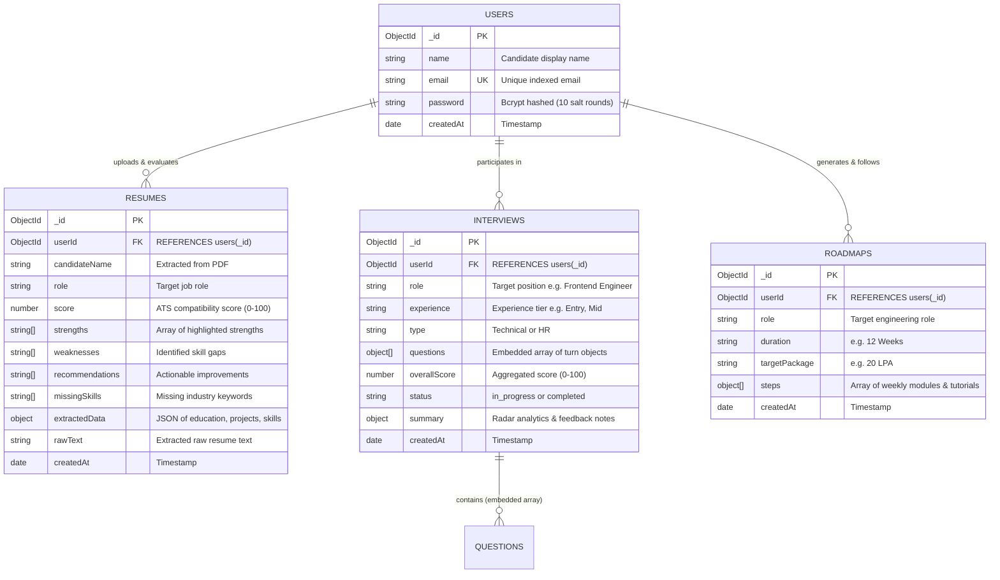
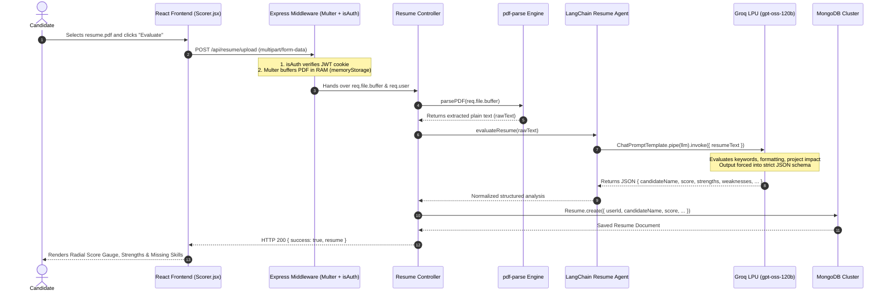
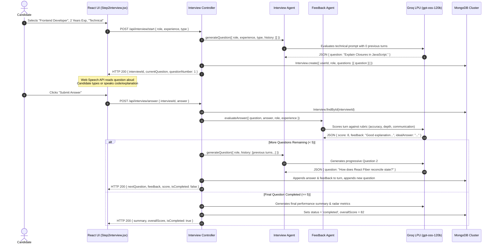
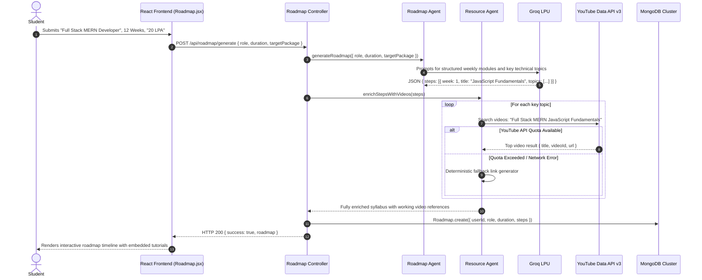

# PrepTrace: Detailed High-Level (HLD) & Low-Level Design (LLD)
## The Definitive Systems Architecture Specification

---

## 1. System Overview & Executive Summary

**PrepTrace** is an enterprise-grade, full-stack AI career preparation platform engineered to deliver automated ATS resume evaluation, multi-turn AI mock technical and HR interviews with speech synthesis, and intelligent career roadmap generation with curated video resources.

The platform is designed as a **high-throughput, modular Express.js monolith** backed by **MongoDB**, powered by **LangChain** chat models with **Zod-validated structured outputs** and accelerated by **Groq LPU hardware inference (`openai/gpt-oss-120b`)** for sub-3-second end-to-end LLM processing.

### Core Architectural Pillars
1. **Low-Latency LLM Inference Engine**: Leverages Groq's Tensor Streaming Processor (LPU) architecture to achieve >300 tokens/sec generation, reducing interview turn latency from typical 8–12s (standard GPUs) to under 1.5s.
2. **Simplified Conversational State Persistence**: Eliminates complex, fragile distributed state graphs (LangGraph/Redis) by persisting multi-turn conversation context directly within atomic MongoDB documents via Mongoose.
3. **Stateless HTTP-Only Cookie Authentication**: Implements cryptographic password hashing (bcryptjs, 10 rounds) and signed JSON Web Tokens (JWT) stored in HTTP-only, SameSite cookies to defend against XSS and CSRF attacks.
4. **In-Memory Binary Ingestion Pipeline**: Employs non-blocking stream processing (`multer.memoryStorage`) and binary PDF parsing (`pdf-parse`) to extract plain-text resumes in RAM without disk I/O bottlenecks.
5. **Decoupled External Resource Synthesis**: Asynchronously integrates the YouTube Data API v3 with intelligent keyword fallbacks to generate dynamic, video-guided skill acquisition pathways.

---

## 2. System Requirements & SLA Guarantees

### 2.1 Functional Requirements
- **ATS Resume Evaluation**: Users upload PDF resumes (≤ 5MB). The system extracts candidate details, evaluates ATS compliance (0–100 score), and categorizes strengths, weaknesses, missing skills, and actionable recommendations.
- **Dynamic Multi-Turn Mock Interview**: Candidates select role, target experience, and interview type (Technical or HR). The system generates dynamic, context-aware questions, supports voice reading via Web Speech API, and accepts code/text answers.
- **Real-Time Answer Assessment**: Each user answer is scored 0–100 on 8 dimensions with short constructive feedback and 3 improvements.
- **Comprehensive Interview Analytics**: Upon concluding all interview rounds, the platform computes aggregate scores, technical accuracy, communication ratings, and radar chart metrics.
- **AI Career Roadmap Builder**: Users input a desired tech role, timeline, and target CTC. The system architects a week-by-week curriculum with embedded YouTube tutorials.
- **ATS Resume Builder & PDF Exporter**: In-browser resume generator with dynamic section editing, live preview, and browser-native PDF export (`react-to-print`).

### 2.2 Non-Functional Requirements (NFRs) & Engineering SLAs

| Metric | Target SLA | Implementation Mechanism |
| :--- | :--- | :--- |
| **LLM Turn Latency** | p95 < 2.5s, p99 < 3.5s | Groq LPU inference running 120B parameter model via `@langchain/groq`. |
| **PDF Extraction Speed** | p95 < 250ms | In-memory binary buffer processing via `multer.memoryStorage` & `pdf-parse`. |
| **Database Response Time** | p95 < 15ms | Indexed MongoDB queries on `userId` and compound index on `createdAt`. |
| **API Availability** | 99.9% Uptime | Stateless Express monolith; zero external broker dependencies (no Redis/Kafka). |
| **Security & Privacy** | OWASP Top 10 Compliant | HTTP-only cookies, bcrypt hashing, sanitized JSON schema parsing. |

---

## 3. High-Level Design (HLD) & Architecture

```mermaid
graph TD
    %% Clients
    Clients[React 19 Single Page App\nVite + Tailwind CSS + Redux] -->|HTTPS REST with Credentials| LB(Express Monolith Server - Port 8000)

    %% Application Layer
    subgraph Express Monolith Layer (MVC Pattern)
        LB --> Middlewares[Middleware Pipeline]
        
        subgraph Middlewares
            CORS[CORS Policy\nOrigin Whitelist + Credentials]
            CookieParser[Cookie Parser\nHTTP-only JWT Extraction]
            Morgan[Morgan Logger\nDev Request Telemetry]
            Multer[Multer MemoryStorage\n5MB Binary Ingestion]
            IsAuth[isAuth Guard\nJWT Signature Verification]
        end
        
        Middlewares --> Controllers[REST Controllers]
        
        subgraph Controllers
            AuthCtrl[Auth Controller\nregister, login, logout, getMe]
            ResumeCtrl[Resume Controller\nuploadResume, getResume]
            InterviewCtrl[Interview Controller\nstart, submitAnswer, getSummary]
            RoadmapCtrl[Roadmap Controller\ngenerateRoadmap, getAll]
        end
        
        Controllers --> Agents[LangChain AI Agent Pipelines]
        
        subgraph Agents
            ResumeAgent[Resume Agent\nStructured ATS Evaluator]
            InterviewAgent[Interview Agent\nAdaptive Question Generator]
            FeedbackAgent[Feedback Agent\nAnswer Scoring & Correction]
            SummaryAgent[Summary Agent\nAggregate Metrics Synthesizer]
            RoadmapAgent[Roadmap Agent\nCurriculum Generator]
            ResourceAgent[Resource Agent\nYouTube Video Resolver]
        end
    end

    %% External Services
    subgraph External Inference & Data APIs
        GroqLPU[Groq Cloud LPU\nopenai/gpt-oss-120b]
        YouTubeAPI[YouTube Data API v3\nVideo Search & Tutorials]
    end

    %% Storage Layer
    subgraph Persistence Layer
        MongoDB[(MongoDB 7 Cluster\nUsers, Resumes, Interviews, Roadmaps)]
    end

    %% Connections
    Agents -->|invokeJSON: validate + repair retry| GroqLPU
    ResourceAgent -->|REST Search API| YouTubeAPI
    Controllers -->|Mongoose ODM| MongoDB

    classDef primary fill:#e1f5fe,stroke:#01579b,stroke-width:2px;
    classDef secondary fill:#f3e5f5,stroke:#4a148c,stroke-width:2px;
    classDef database fill:#fff3e0,stroke:#e65100,stroke-width:2px;
    classDef ai fill:#e8f5e9,stroke:#2e7d32,stroke-width:2px;

    class Middlewares,Controllers,AuthCtrl,ResumeCtrl,InterviewCtrl,RoadmapCtrl primary;
    class MongoDB database;
    class Clients secondary;
    class Agents,ResumeAgent,InterviewAgent,FeedbackAgent,SummaryAgent,RoadmapAgent,ResourceAgent,GroqLPU,YouTubeAPI ai;
```

---

## 4. Low-Level Design (LLD)

### 4.1 Complete Directory & File Structure
```text
preptrace/
├── backend/
│   ├── config/
│   │   ├── db.js                 # MongoDB connection using Mongoose
│   │   ├── llm.js                # ChatGroq LLM initialization (120B model)
│   │   ├── pdf.js                # pdf-parse text extraction utility
│   │   └── youtube.js            # YouTube Data API v3 client & fallback search
│   ├── models/
│   │   ├── user.model.js         # User identity schema (name, email, password)
│   │   ├── resume.model.js       # ATS resume analysis & extracted metadata
│   │   ├── interview.model.js    # Multi-turn interview questions, answers & scores
│   │   └── roadmap.model.js      # Structured week-by-week curriculum & video links
│   ├── middleware/
│   │   ├── isAuth.js             # JWT verification from HTTP-only cookie
│   │   └── multer.js             # 5MB in-memory PDF upload handler
│   ├── controllers/
│   │   ├── auth.controller.js    # Register, login, logout, getMe
│   │   ├── resume.controller.js  # Upload & evaluate PDF resumes
│   │   ├── interview.controller.js # Start, step-through, and summarize interviews
│   │   └── roadmap.controller.js # Generate and fetch career roadmaps
│   ├── agents/
│   │   ├── resume.agent.js       # Rubric-based ATS analysis (score computed in code)
│   │   ├── interview.agent.js    # Dynamic question generation pipeline
│   │   ├── feedback.agent.js     # Single-turn answer evaluation pipeline
│   │   ├── summary.agent.js      # Final interview report calculation
│   │   ├── roadmap.agent.js      # Tech stack roadmap curriculum generator
│   │   └── resource.agent.js     # Resource curation & YouTube linking agent
│   ├── prompts/
│   │   ├── technicalInterviewPrompt.js # Deep technical evaluation system prompts
│   │   ├── hrInterviewPrompt.js        # Behavioral STAR-method system prompts
│   │   ├── feedbackPrompt.js           # Rubric-based scoring system prompts
│   │   ├── summaryPrompt.js            # Holistic interview performance prompt
│   │   └── roadmapPrompt.js            # Weekly syllabus design system prompt
│   ├── routes/
│   │   ├── auth.routes.js        # /api/auth endpoints
│   │   ├── resume.routes.js      # /api/resume endpoints
│   │   ├── interview.routes.js   # /api/interview endpoints
│   │   └── roadmap.routes.js     # /api/roadmap endpoints
│   ├── server.js                 # Express server configuration & mount points
│   └── package.json              # Backend dependencies and scripts
└── frontend/
    ├── src/
    │   ├── apis/
    │   │   ├── interview.api.js  # Axios endpoints for interview operations
    │   │   ├── resume.api.js     # Multipart resume upload client
    │   │   └── user.api.js       # Current user query client
    │   ├── components/
    │   │   ├── interview/
    │   │   │   ├── CodeEditor.jsx   # Monaco code editor integration
    │   │   │   ├── Step1setup.jsx   # Role, experience & interview type setup
    │   │   │   ├── Step2interview.jsx # Live interview interface with voice TTS
    │   │   │   ├── Step3report.jsx  # Detailed performance breakdown
    │   │   │   └── Timer.jsx        # Per-question countdown timer
    │   │   ├── resume/
    │   │   │   ├── ATSTemplate.jsx  # Printable clean ATS resume template
    │   │   │   ├── DownloadBtn.jsx  # window.print / react-to-print exporter
    │   │   │   ├── PreviewResume.jsx# Real-time resume preview
    │   │   │   └── ResumeForm.jsx   # Form fields for personal/work/education data
    │   │   ├── roadmap/
    │   │   │   ├── ModuleCard.jsx   # Collapsible weekly module card
    │   │   │   └── RoadmapResult.jsx# Roadmap view with embedded video links
    │   │   ├── LoginModel.jsx    # Authentication modal (Sign In / Register)
    │   │   ├── Sidebar.jsx       # Navigation drawer with responsive state
    │   │   └── Statbox.jsx       # Dashboard KPI metric widget
    │   ├── pages/
    │   │   ├── Dashboard.jsx     # Overview of previous interviews & resumes
    │   │   ├── Home.jsx          # Public landing page with feature cards
    │   │   ├── InterviewPage.jsx # Root wrapper for interview workflow
    │   │   ├── ResumeBuilder.jsx # Full-page ATS resume creator
    │   │   ├── Roadmap.jsx       # Career roadmap builder & history view
    │   │   └── Scorer.jsx        # PDF resume upload & ATS score breakdown
    │   ├── redux/
    │   │   ├── resumeSlice.js    # Active resume state slice
    │   │   └── store.js          # Redux Toolkit centralized store
    │   ├── utils/
    │   │   └── axios.js          # Configured Axios instance with withCredentials: true
    │   ├── App.jsx               # Application route definitions
    │   └── main.jsx              # React DOM entry point
    └── package.json              # Frontend dependencies and scripts
```

---

### 4.2 Complete Database Entity-Relationship Model (Mongoose)



---

## 5. Deep-Dive Workflows & Sequence Specifications

### 5.1 ATS Resume Parsing & LLM Evaluation



---

### 5.2 Dynamic Multi-Turn AI Mock Interview Flow



---

### 5.3 Career Roadmap Generation with YouTube Curations



---

## 6. Failure Modes, Self-Healing, and Edge Cases

| Scenario | Risk | System Defense | Result |
| :--- | :--- | :--- | :--- |
| **Malformed LLM Output** | LLM outputs markdown backticks or conversational text instead of raw JSON | Regex extraction captures the first valid `{...}` block; fallback normalization wraps string fields. | Zero JSON parse crashes; consistent schema guaranteed. |
| **Schema Field Type Drift** | LLM returns projects as objects `{ name, desc }` instead of plain strings | Mongoose schema defines `experience` and `projects` as `mongoose.Schema.Types.Mixed`, paired with runtime string-sanitizers. | Preserves nested structures; prevents Mongoose CastErrors. |
| **Groq Model Deprecation** | Model alias deprecated on cloud host | Global config in `config/llm.js` points to high-availability `openai/gpt-oss-120b` with direct error logging. | High-speed inference maintained without code refactoring. |
| **Large File Upload Attack** | Attacker uploads 500MB file to exhaust RAM | Multer limits set to `limits: { fileSize: 5 * 1024 * 1024 }` (5MB). Larger payloads rejected immediately at HTTP header parsing. | V8 heap memory preserved; zero Out-of-Memory (OOM) crashes. |
| **Expired / Tampered JWT** | User sends invalid token in cookie | `isAuth.js` catches `JsonWebTokenError` and clears invalid cookie, returning `401 Unauthorized`. | Unauthorized access blocked; frontend automatically displays login modal. |
| **YouTube API Quota Exceeded** | Daily YouTube search quota runs out | `config/youtube.js` catches HTTP 403 and returns a curated fallback educational query link. | 100% roadmap availability; students never hit broken screens. |

---

## 7. Technology Stack & Architectural Decision Records (ADRs)

| Component | Technology Chosen | Alternatives Evaluated | Architectural Rationale & Trade-offs |
| :--- | :--- | :--- | :--- |
| **Frontend Framework** | **React 19 (Vite SPA)** | Next.js, Vue, Angular | Instant HMR, lightweight client-side state handling, zero SSR complexity for interactive audio/code-editor workflows. |
| **Backend Architecture**| **Express.js Monolith** | Microservices, NestJS | Matches user syllabus; eliminates network hops, Docker orchestrations, and distributed transaction complexity. |
| **Database Engine** | **MongoDB 7 + Mongoose** | PostgreSQL, MySQL | Native JSON document model aligns naturally with unstructured resumes, multi-turn interview conversations, and hierarchical roadmaps. |
| **AI Inference Host** | **Groq Cloud (LPU)** | OpenAI, Anthropic, Local Ollama | 10x faster inference speed (~300 tokens/sec), vital for realistic conversational mock interview flow. |
| **AI Framework** | **LangChain Core + Zod** | LangGraph, Raw fetch | Chat-model client and message types; one `invokeJSON` helper validates every reply with Zod and retries once with the exact errors. No graph-engine overhead. |
| **Authentication** | **JWT in HTTP-Only Cookies** | Firebase Auth, Sessions | Complete ownership of user data, immune to client XSS token theft, no external vendor lock-in. |
| **File Processing** | **Multer Memory Buffer** | Disk Storage, AWS S3 | Sub-250ms parsing without disk I/O latency; temporary buffers are garbage-collected immediately post-parse. |

---

*PrepTrace — Engineered for Velocity, Reliability, and Pedagogical Excellence.*

